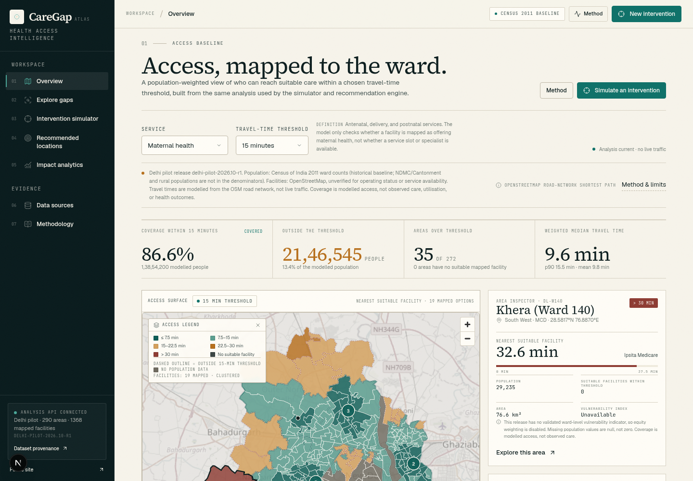
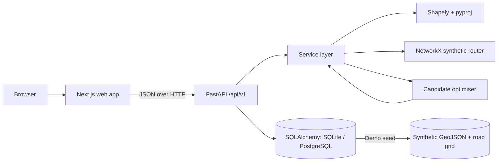

# CareGap

**Healthcare accessibility and resource planning for the synthetic Demo District.**

CareGap is a map-first decision-support workspace. It calculates who can reach
suitable healthcare within a chosen travel-time threshold, shows where access
gaps are concentrated, simulates a proposed clinic or outreach resource, and
ranks alternative locations with an explainable heuristic.

> **Demonstration build.** The bundled district, population, vulnerability
> index, facilities, and road network are synthetic. Accessibility values are
> model estimates, not observed care, live traffic, clinical outcomes, or proof
> that a facility is staffed and available. Read the [method and limitations](docs/methodology.md)
> before interpreting a result.



## What it does

- **Overview** — a live access surface: covered and uncovered population, ward
  travel times, mapped facilities, and a ward inspector.
- **Explore gaps** — a searchable, sortable table of every population area with
  CSV export, linked to the same map.
- **Intervention simulator** — choose a resource type, place up to five proposed
  sites, select a service and threshold, and compare baseline vs proposed access,
  equity, residual gaps, and the worst-served population.
- **Recommended locations** — rank population-area centroids with a documented
  composite score, compare equity-weighted and maximum-coverage greedy sets, and
  read the evidence behind each candidate.
- **Impact analytics** — recompute saved scenarios, visualise travel-time
  distribution and newly covered population, and inspect residual gaps and
  equity.
- **Data sources** — source register, field-level provenance, validation rules,
  and a working CSV/GeoJSON import path.
- **Methodology** — formulas, score weights, invariants, limitations, privacy
  posture, and the design record.

## Stack

| Layer | Implementation |
| --- | --- |
| Frontend | Next.js 16 (App Router), React 19, TypeScript 5.9, Tailwind CSS 4, MapLibre GL JS 6, Recharts 3 |
| Backend | Python 3.12+, FastAPI, Pydantic 2, SQLAlchemy 2, Alembic |
| Spatial analysis | Shapely, pyproj, NetworkX |
| Database | SQLite by default; PostgreSQL is supported and verified; PostGIS is enabled in the optional Compose database |
| Demo data | Deterministic synthetic GeoJSON generated by a committed script |
| Testing | pytest, Vitest + Testing Library, Playwright end-to-end |
| CI/CD | GitHub Actions (lint, typecheck, tests, migrations, production build, E2E) |
| Containers | Dockerfiles and `compose.yaml` for API, web, and a PostGIS database |

The demo deliberately keeps spatial analysis in a small Python service instead of
a microservice fleet. Spatial operations are deterministic and covered by tests.
The app stores GeoJSON in portable JSON columns; native PostGIS geometry columns
are a documented roadmap item, not a current feature.

## Quick start

Prerequisites: Python 3.12+, Node.js 24 (Node 20.9+ is the Next.js floor), and
npm. The local demo does not need PostGIS, Docker, paid APIs, or an API key.

```bash
# 1. Backend dependencies (from the repository root)
python3 -m venv .venv
.venv/bin/pip install -r backend/requirements.txt

# 2. Start the API (terminal 1)
cd backend
../.venv/bin/uvicorn app.main:app --reload --port 8000
```

On startup the API creates the SQLite database if needed, seeds the synthetic
dataset idempotently, and builds the travel-time router.

```bash
# 3. Frontend dependencies and dev server (terminal 2, from the repository root)
cd frontend
npm ci
npm run dev
```

Open <http://localhost:3000> for the public landing page and the workspace.
Open <http://localhost:8000/docs> for the interactive OpenAPI reference.

Optional configuration: copy `.env.example` to `.env`. Defaults work without it.
Delete `backend/caregap.db` to reset the local database.

### Production build

```bash
cd frontend
npm run build
npm run start        # warns because output: standalone; see docs/deployment.md
```

For a self-contained runtime, use the Docker image or run the standalone server
described in [docs/deployment.md](docs/deployment.md).

### Docker Compose (optional, PostgreSQL + PostGIS)

```bash
cp .env.example .env
# Replace POSTGRES_PASSWORD in .env with a local-only value.
docker compose up --build
```

This starts the PostGIS database, runs Alembic migrations, starts the API and
web app. The default web URL is <http://localhost:3000>. Compose requires the
password placeholder to be changed; no credentials are committed.

## Verify the project

Run the complete local check suite:

```bash
./scripts/check.sh
```

Or individually:

```bash
# Backend lint + tests (64 tests verified)
cd backend
../.venv/bin/ruff check app tests
../.venv/bin/pytest -q

# Frontend lint, types, unit tests, production build (29 tests verified)
cd ../frontend
npm run lint
npm run typecheck
npm test
npm run build

# End-to-end (starts backend and frontend automatically; 9 tests verified locally)
npx playwright install chromium
PLAYWRIGHT_CHROME_PATH=/usr/bin/google-chrome npx playwright test
```

Local E2E was run with the system Chrome (`PLAYWRIGHT_CHROME_PATH`). CI installs
the matching Playwright Chromium build instead. Test commands and coverage are
documented in [docs/testing.md](docs/testing.md).

## Architecture



Key design decisions:

- **One analysis engine.** Overview, simulation, recommendations, and analytics
  all call the same deterministic accessibility functions in
  `backend/app/services/analysis.py`. Displayed values are never fabricated by
  the UI.
- **Service suitability.** The nearest facility is only eligible if it is mapped
  as offering the selected service.
- **Additive simulation.** New facilities are added; existing facilities are
  never removed. Under this model, an area's nearest-facility travel time cannot
  worsen (covered by automated invariant tests).
- **Explainable ranking.** Candidate scores expose their normalised components,
  benefits, residual gaps, and assumptions. The greedy set is explicitly not
  claimed to be globally optimal.
- **Optional AI.** No LLM is required or called. Explanations are deterministic
  summaries of computed results, so the product is fully usable offline.

More detail: [architecture](docs/architecture.md), [API](docs/api.md),
[methodology](docs/methodology.md), [data sources](docs/data-sources.md).

## Demo dataset

Everything in `backend/app/data/demo/` is synthetic and generated by
`backend/scripts/generate_demo_data.py` with seed `20261024`:

- 96 synthetic population areas, 3.57 million modelled people
- 6 fictional mapped facilities with invented service suitability
- a synthetic 2.0 km street grid and a deterministic travel-time model
- a synthetic vulnerability index used only for demonstration equity weighting

The dataset contains no patient-identifiable data and is not a real district.
Regenerate it with:

```bash
.venv/bin/python backend/scripts/generate_demo_data.py
```

Source, licensing, candidate real-data sources, and limitations are recorded in
[docs/data-sources.md](docs/data-sources.md). The map basemap uses OpenStreetMap
tiles with attribution; production use requires a tile provider with an
appropriate plan.

## Data import

The Data Sources workspace accepts:

- **Facilities:** CSV (`.csv`) or GeoJSON points, with `name`, `facility_type`,
  `lon`, `lat`, and optional `services`.
- **Population areas:** GeoJSON Polygon/MultiPolygon features with `name`,
  `population`, and optional `vulnerability_index`.

Validation includes coordinate ranges, schema, service identifiers, geometry
validity, population, boundary containment for facility points, duplicate
detection, a 2 MB default limit, and a 5,000-row cap. Every import is recorded
with a report and validation errors. See
[import rules](docs/methodology.md#data) and the live API docs.

## Security and privacy

- No patient-identifiable data is collected or required.
- Secrets are read from environment variables; `.env` files are gitignored.
- Imports are size-limited, validated, and recorded.
- CORS is restricted to configured origins.
- API errors do not expose stack traces or database internals.
- The local build has **no authentication, authorisation, or rate limiting**.
  It must not be exposed publicly until those controls and a security review are
  completed. See [SECURITY.md](SECURITY.md) and
  [deployment](docs/deployment.md).

## Status and limitations

This is a private demonstration build at v0.1.0, not a deployed service.

Known limitations include synthetic data, an incomplete facility inventory,
capacity/staffing/hours/cost/quality being unmodelled, no live traffic, no health
outcome claims, a coarser area-centroid candidate grid, and a heuristic
optimisation. The complete list is in
[docs/methodology.md#limitations](docs/methodology.md#limitations) and the
in-app Methodology page.

## Licence

No open-source licence has been granted yet. The repository is private and the
current [LICENSE](LICENSE) reserves all rights. The owner must deliberately
choose and confirm a licence before any public distribution. The synthetic demo
data is generated by this repository; third-party design research and basemap
attribution are recorded in [docs/credits.md](docs/credits.md).

## Documentation

- [Architecture](docs/architecture.md)
- [API reference](docs/api.md)
- [Methodology and limitations](docs/methodology.md)
- [Data sources and provenance](docs/data-sources.md)
- [Testing guide](docs/testing.md)
- [Deployment guide](docs/deployment.md)
- [Design audit](docs/design-audit.md)
- [Roadmap](docs/roadmap.md) · [Changelog](docs/changelog.md)
- [Contributing](CONTRIBUTING.md) · [Security](SECURITY.md) · [Code of conduct](CODE_OF_CONDUCT.md)

## Acknowledgements

- Map tiles © OpenStreetMap contributors.
- Fonts: Source Serif 4, Geist, and JetBrains Mono (open-source font licences).
- Design research: InstaLanding.ai (MIT). Halden lineage credits the 8B Reflow
  template (MIT). No reference code or assets are redistributed. See
  [docs/credits.md](docs/credits.md).
