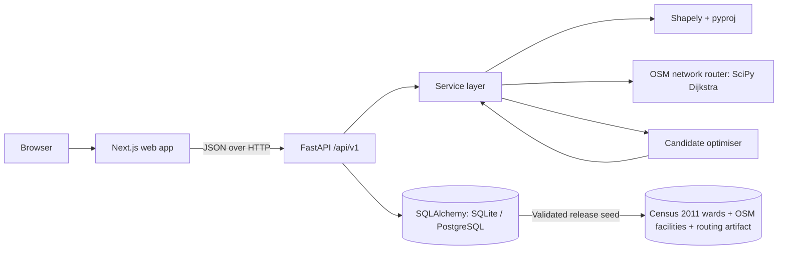

# CareGap

**Healthcare accessibility and intervention planning for the National Capital
Territory of Delhi.**

CareGap is a map-first decision-support workspace. It estimates who can reach a
suitable healthcare facility within a chosen travel-time threshold, shows where
modelled access gaps are concentrated, simulates a proposed clinic or outreach
resource, and ranks alternative locations with an explainable heuristic.

> **Pilot release, not a deployed service.** The Delhi pilot uses **Census of
> India 2011** ward populations (a historical baseline) and **OpenStreetMap**
> facilities and roads. It models geographic access; it does not verify that a
> facility is staffed, open, affordable, or clinically appropriate. Coverage is
> not observed care, utilisation, or health outcome. Read
> [the methodology](docs/methodology.md) and the
> [data-quality report](docs/data-quality-report.md) before interpreting a
> result.


## The Delhi pilot at a glance

| Field | Value |
| --- | --- |
| Study area | NCT of Delhi (OSM relation 1942586), 1,482 km² |
| Analysis units | 290 ward/charge polygons: 272 MCD wards + 9 NDMC + 8 Cantonment + 1 unassigned riverbed |
| Population | Census of India 2011 ward PCA: **16,000,745** people in 272 wards |
| Not represented | 787,196 people (4.7% of the 2011 NCT total): NDMC, Cantonment, rural village population, boundary mismatch |
| Facilities | **1,368** OpenStreetMap care facilities after filtering and deduplication |
| Roads | 125,452 OSM drivable ways; 532,088-node routing graph; 99.5% in the largest component |
| Routing | Shortest path over OSM roads; documented class speeds; local-access estimate; **not live traffic** |
| Vulnerability | **Unavailable.** No defensible ward-level indicator was acquired; equity weighting is disabled rather than fabricated |
| Release | `delhi-pilot-2026.10-r1` |

**Default lens:** maternal health within 15 minutes — a configurable analytical
assumption chosen to surface variation, not a clinical standard. At that lens,
86.6% of represented people are within the threshold and 35 wards are outside.
Primary-care coverage is near-saturated in the mapped inventory (100% within 15
minutes); emergency and diagnostics show smaller gaps. Switch service or
threshold in the workspace to inspect them.

## What it does

- **Overview** — a live access surface: covered and uncovered population, ward
  travel times, mapped facilities, and a ward inspector.
- **Explore gaps** — a searchable, sortable table of every population area with
  CSV export, linked to the same map.
- **Intervention simulator** — choose a resource type, place up to five proposed
  sites, select a service and threshold, and compare baseline vs proposed access,
  equity, residual gaps, and the worst-served population.
- **Recommended locations** — rank populated ward representative points with a
  documented composite score, compare coverage and equity-weighted greedy sets,
  and read the evidence behind each candidate. Equity weighting is shown as
  unavailable when the dataset has no vulnerability input.
- **Impact analytics** — recompute saved scenarios, visualise travel-time
  distribution and newly covered population, and inspect residual gaps.
- **Data sources** — source register, field-level provenance (OSM ID, tags,
  address, ward), validation summary, and a working facility import path.
- **Methodology** — formulas, score weights, invariants, limitations, privacy
  posture, and the design record.

## Stack

| Layer | Implementation |
| --- | --- |
| Frontend | Next.js 16 (App Router), React 19, TypeScript 5.9, Tailwind CSS 4, MapLibre GL JS 6, Recharts 3 |
| Backend | Python 3.12+, FastAPI, Pydantic 2, SQLAlchemy 2, Alembic |
| Spatial analysis | Shapely, pyproj, NumPy, SciPy, NetworkX |
| Database | SQLite by default; PostgreSQL 16 + PostGIS verified locally |
| Data | Census 2011 ward PCA, DataMeet ward boundaries, OpenStreetMap facilities and roads |
| Testing | pytest, Vitest + Testing Library, Playwright end-to-end |
| CI/CD | GitHub Actions (lint, typecheck, tests, migrations, production build, E2E) |
| Containers | Dockerfiles and `compose.yaml` for API, web, and a PostGIS database |

## Quick start

Prerequisites: Python 3.12+, Node.js 24 (Node 20.9+ is the Next.js floor), and
npm. The local pilot does not need PostGIS, Docker, paid APIs, or an API key.
The committed Delhi release is about 14 MB.

```bash
# 1. Backend dependencies (from the repository root)
python3 -m venv .venv
.venv/bin/pip install -r backend/requirements.txt

# 2. Start the API (terminal 1)
cd backend
../.venv/bin/uvicorn app.main:app --reload --port 8000
```

On startup the API creates the SQLite database if needed, validates and seeds the
active dataset, and builds the routing model. The default active profile is
`delhi-pilot`. A missing or invalid real-data release **stops startup** with an
actionable error; it never falls back to synthetic data.

```bash
# 3. Frontend dependencies and dev server (terminal 2, from the repository root)
cd frontend
npm ci
npm run dev
```

Open <http://localhost:3000> for the landing page and workspace.
Open <http://localhost:8000/docs> for the OpenAPI reference.

Optional configuration: copy `.env.example` to `.env`. Defaults work without it.
Delete `backend/caregap.db` to reset the local database.

### Switch to the synthetic demo

The deterministic synthetic district remains available for development and
tests. It is always labelled as synthetic.

```bash
cd backend
CAREGAP_ACTIVE_DATASET=caregap-demo ../.venv/bin/uvicorn app.main:app --port 8000
```

To use both profiles, use separate databases (the startup seeder loads exactly
one active profile and never mixes records). Dataset provenance is exposed at
`/api/v1/meta` and `/api/v1/datasets`.

### Rebuild the Delhi release

Raw downloads are not committed. To reproduce the release from source:

```bash
.venv/bin/pip install -r backend/requirements-data.txt
.venv/bin/python backend/scripts/fetch_delhi_sources.py   # ~140 MB, ~3 min
.venv/bin/python backend/scripts/build_delhi_dataset.py   # ~2–3 min
```

This regenerates `backend/app/data/delhi/` and
`docs/data-quality-report.md`. Source URLs, retrieval dates, licences, and
SHA-256 checksums are recorded by the fetch script.

### Production build

```bash
cd frontend
npm run build
npm run start
```

For a self-contained runtime, use the Docker image or the Next standalone server
described in [docs/deployment.md](docs/deployment.md).

### Docker Compose (PostgreSQL + PostGIS)

```bash
cp .env.example .env
# Replace POSTGRES_PASSWORD in .env with a local-only value.
docker compose up --build
```

This starts the PostGIS database, runs Alembic migrations, starts the API and
web app. The default web URL is <http://localhost:3000>. Compose requires the
password placeholder to be changed; no credentials are committed.

## Verify the project

Run the complete local check suite:

```bash
./scripts/check.sh
```

Or individually:

```bash
# Backend lint + tests (98 tests verified locally)
cd backend
../.venv/bin/ruff check app tests
../.venv/bin/pytest

# Frontend lint, types, unit tests, production build (33 tests verified)
cd ../frontend
npm run lint
npm run typecheck
npm test
npm run build

# End-to-end (starts backend and frontend automatically; 9 tests verified locally)
npx playwright install chromium
PLAYWRIGHT_CHROME_PATH=/usr/bin/google-chrome npx playwright test
```

Local E2E was run with the system Chrome. CI installs the matching Playwright
Chromium build instead. Test commands and coverage are documented in
[docs/testing.md](docs/testing.md).

**Deployment verification performed locally:** Alembic upgrade → downgrade →
upgrade on SQLite and on PostgreSQL 16 + PostGIS 3.4 (Docker Compose), a live API
run against PostgreSQL returning the same Delhi release and coverage figures,
and both Docker images built and run (web against the live API). The complete
three-container Compose orchestration was not run in one command. CI additionally
runs both migration paths.

## Architecture



Key design decisions:

- **One analysis engine.** Overview, simulation, recommendations, and analytics
  all call the same deterministic accessibility functions in
  `backend/app/services/analysis.py`. Displayed values are never fabricated by
  the UI.
- **Service suitability.** The nearest facility is only eligible if it is mapped
  as offering the selected service. In Delhi, services come only from OSM tags.
- **Explicit dataset profiles.** `delhi-pilot` and `caregap-demo` are separate
  releases with separate provenance. The API loads one active profile and never
  mixes them.
- **No synthetic fallback.** A missing real-data manifest or road artifact stops
  startup. The straight-line fallback exists only for the synthetic demo and is
  labelled in every response.
- **Null, not zero.** Areas without a valid population carry `population: null`
  and are excluded from denominators; they are never silently counted as zero.
- **Additive simulation.** New facilities are added; existing facilities are
  never removed. Under this model, an area's nearest-facility travel time cannot
  worsen (covered by automated invariant tests).
- **Explainable ranking.** Candidate scores expose their normalised components,
  benefits, residual gaps, and assumptions. The greedy set is explicitly not
  claimed to be globally optimal.
- **Optional AI.** No LLM is required or called.

More detail: [architecture](docs/architecture.md), [API](docs/api.md),
[methodology](docs/methodology.md), [data sources](docs/data-sources.md),
[Delhi pilot](docs/delhi-pilot.md).

## Data import

The Data Sources workspace accepts facility CSVs (`.csv`) or GeoJSON points,
with `name`, `facility_type`, `lon`, `lat`, and optional `services`. Population
area imports are available for the synthetic demo but **disabled for Delhi**,
because the release must match the validated Census ward set.

Validation includes coordinate ranges, schema, service identifiers, geometry
validity, population, boundary containment, duplicate detection, a 2 MB default
limit, and a 5,000-row cap. Every import is recorded with a report and validation
errors. See [import rules](docs/methodology.md#data) and the live API docs.

## Security and privacy

- No patient-identifiable data is collected or required.
- Secrets are read from environment variables; `.env` files are gitignored.
- Imports are size-limited, validated, and recorded.
- CORS is restricted to configured origins.
- API errors do not expose stack traces or database internals.
- `CAREGAP_READ_ONLY=true` disables scenario creation and data imports for a
  public demonstration. The default local build is writable.
- The API has **no authentication, authorisation, or built-in rate limiting**.
  It must not be exposed publicly without those controls and a security review.
  See [SECURITY.md](SECURITY.md) and [docs/security.md](docs/security.md).

## Status and limitations

This is a private pilot build at v0.2.0, not a deployed service.

Known limitations include historical 2011 population, partial population
coverage, an incomplete and unverified facility inventory, no capacity/staffing/
hours/cost/quality, no live traffic, no vulnerability input, coarse ward
centroids, a heuristic optimiser, and no authentication. The complete list is in
[docs/methodology.md#limitations](docs/methodology.md#limitations) and the
in-app Methodology page.

## Licence

CareGap is **proprietary and confidential**. The repository is private and all
rights are reserved; no open-source licence is granted. See [LICENSE](LICENSE).
Third-party data attribution and data-specific terms (OpenStreetMap ODbL,
DataMeet CC BY-SA 2.5 IN, Census of India) are recorded in
[docs/data-licenses.md](docs/data-licenses.md) and
[docs/credits.md](docs/credits.md).

## Documentation

- [Delhi pilot scope and release](docs/delhi-pilot.md)
- [Data sources and provenance](docs/data-sources.md)
- [Data licences and attribution](docs/data-licenses.md)
- [Data-quality report](docs/data-quality-report.md)
- [Methodology and limitations](docs/methodology.md)
- [Architecture](docs/architecture.md)
- [API reference](docs/api.md)
- [Testing guide](docs/testing.md)
- [Deployment guide](docs/deployment.md)
- [Security review](docs/security.md)
- [Demo script](docs/demo-script.md)
- [Design audit](docs/design-audit.md)
- [Roadmap](docs/roadmap.md) · [Changelog](docs/changelog.md)
- [Contributing](CONTRIBUTING.md) · [Security](SECURITY.md) · [Code of conduct](CODE_OF_CONDUCT.md)

## Acknowledgements

- Population: Census of India 2011, Office of the Registrar General & Census
  Commissioner.
- Ward boundaries: DataMeet Municipal_Spatial_Data (CC BY-SA 2.5 IN).
- Facilities and roads: © OpenStreetMap contributors, ODbL 1.0.
- Map tiles © OpenStreetMap contributors.
- Fonts: Source Serif 4, Geist, and JetBrains Mono (open-source font licences).
- Design research: InstaLanding.ai (MIT). Halden lineage credits the 8B Reflow
  template (MIT). No reference code or assets are redistributed. See
  [docs/credits.md](docs/credits.md).
