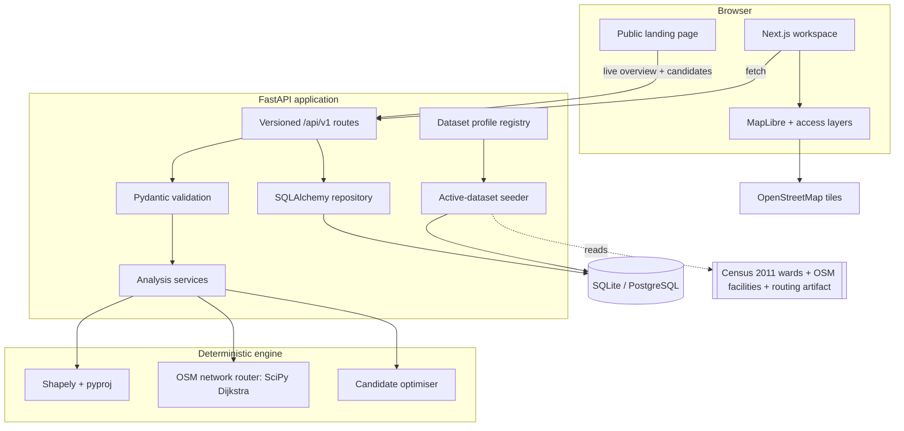
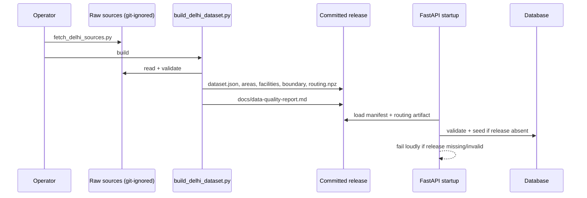
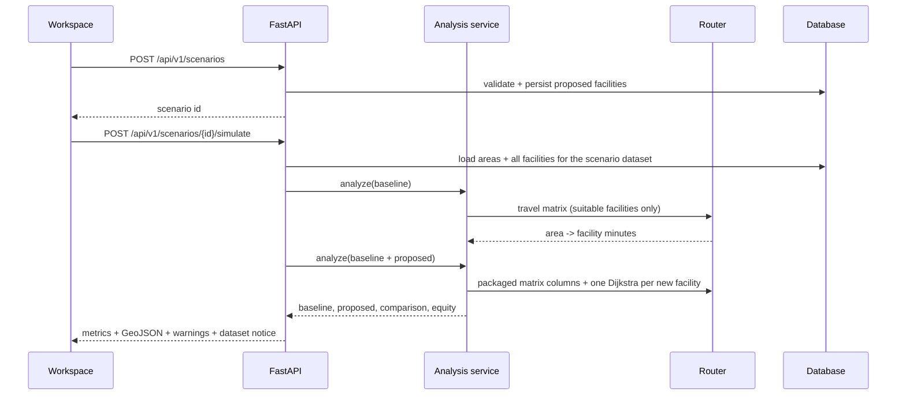

# Architecture

CareGap v0.2 is a two-application system with a deterministic Python analysis
engine and a Next.js workspace. It deliberately avoids microservices: the
analysis workload is small, reproducibility matters more than horizontal
elasticity, and the pilot must run offline without paid infrastructure.

## Components

### Frontend (`frontend/`)

- Next.js App Router, React 19, TypeScript.
- Public landing at `/`; operational workspace at `/app/*`.
- MapLibre GL JS is loaded only on the client. The worker is copied from
  `node_modules` into `public/` by `scripts/copy-maplibre-worker.mjs` during
  `predev`/`prebuild`, then registered with
  `maplibre.setWorkerUrl('/maplibre-gl-worker.mjs')`.
- All displayed metrics come from the API; there are no hard-coded KPI values or
  fake charts. Loading, empty, and error states are explicit.
- The workspace header, footer, data page, map legend, and exports identify the
  active dataset, release, population reference year, and routing model.
- `NEXT_PUBLIC_API_URL` selects the API origin and is baked into the client build.
- `scripts/capture-screenshots.mjs` captures the landing screenshots from a
  running stack (not mocked up).

### Backend (`backend/`)

| Path | Responsibility |
| --- | --- |
| `app/main.py` | App factory, lifespan, schema check, seeding, routing, CORS, security headers, routers. |
| `app/config.py` | Environment settings (`CAREGAP_*`), active dataset, read-only, docs, allowed hosts. |
| `app/datasets.py` | Dataset profile registry, release manifest loading, router selection, loud failure on missing real data. |
| `app/models.py` | SQLAlchemy models: datasets, areas, facilities, scenarios, import runs; range constraints. |
| `app/seed.py` | Validated, idempotent seeding of the active release; refuses release mismatch without explicit replacement. |
| `app/core/catalog.py` | Service, facility, and intervention definitions (single source of truth). |
| `app/services/routing.py` | Synthetic grid router, packaged OSM network router, labelled straight-line fallback for the demo only. |
| `app/services/analysis.py` | Service-filtered nearest facility, coverage, weighted statistics, equity, comparison; vectorised fast path. |
| `app/services/optimization.py` | Candidate evaluation, composite score, strategy comparisons, greedy sets. |
| `app/services/importer.py` | CSV/GeoJSON parsing, validation, duplicates, boundary checks. |
| `app/api/*` | Versioned REST routes and Pydantic response contracts. |
| `alembic/` | Versioned schema migrations (`af8d1f78b2a6` → `3c9a1e6f2b10`). |
| `scripts/build_delhi_dataset.py` | Offline release build: validation, clipping, deduplication, graph, matrices, quality report. |
| `scripts/fetch_delhi_sources.py` | Documented, checksummed raw-source retrieval. |
| `scripts/refresh_dataset.py` | Deliberate transactional release replacement. |

## Dataset flow

The API loads exactly one profile per process (`CAREGAP_ACTIVE_DATASET`). There
is no synthetic fallback for a real-data profile. An existing database with a
different release is refused at startup; `refresh_dataset.py` performs a
deliberate, validated replacement.

## Analysis flow

### Routing

**Delhi profile.** The release ships a CSR graph, node coordinates, area/facility
snaps, a baseline facility-to-area matrix, and an area-to-area matrix for
candidate ranking. Known pairs are read from the matrix. A proposed facility is
snapped and evaluated with one SciPy Dijkstra run; a facility placed exactly at a
ward representative point reuses the precomputed area row. Travel time is
shortest-path minutes plus a documented local-access leg. One-way restrictions
and turn restrictions are not modelled.

**Synthetic profile.** A deterministic 2.0 km grid with plausible speed classes
and NetworkX Dijkstra. If the demo grid cannot load, a labelled straight-line
fallback (1.35 detour, 28 km/h) is used. This fallback is never used for Delhi.

### Database

- SQLite by default, created at `backend/caregap.db`; `create_all` is used for
  local convenience. Alembic migrations are authoritative and run in Compose/CI.
- PostgreSQL is supported via `postgresql+psycopg://`. Verified locally against
  PostgreSQL 16 with PostGIS 3.4: upgrade → downgrade → upgrade, plus a live API
  run returning the Delhi release and coverage figures.
- The current schema stores GeoJSON in JSON columns and does not use native
  geometry types. PostGIS is enabled in Compose for future spatial work.
- All API writes occur in a request-scoped SQLAlchemy session; imports commit
  valid rows and record an `import_runs` provenance row.
- Scenario, area, facility, and import queries are scoped by `dataset_id`.

### Error and security handling

- Pydantic validates every request body and query; FastAPI returns 422 for
  invalid requests.
- Domain errors use explicit 403/404/409/422/503 responses with readable `detail`.
- Unhandled errors are logged server-side and return
  `{"detail": "Internal server error"}`.
- CORS is allow-listed; optional TrustedHost middleware; security headers include
  `nosniff`, frame denial, referrer policy, and API `Cache-Control: no-store`.
- Imported files are read by size limit, validated, and never used as shell input
  or interpreted code.
- `CAREGAP_READ_ONLY=true` disables scenario creation and data imports.
- No authentication is included. Public deployment requires identity,
  authorisation, rate limiting, and audit logging.

## Important deviations

| Suggested | Implemented | Reason |
| --- | --- | --- |
| GeoPandas + PostGIS geometry | Shapely + pyproj over a portable schema | The pilot is small; this provides a deterministic offline data path and simpler tests. PostGIS is available in Compose but not required. |
| Live OSRM/Valhalla | Packaged OSM graph + documented speeds | No external routing dependency or live-traffic claim; the router abstraction allows a real engine later. |
| LLM explanations | Deterministic server-generated explanations | The tool must work without keys; arbitrary text is not allowed to invent numbers. |
| Microservices | Single FastAPI service | No demonstrated scaling need; keeps latency and operations simple. |

## Scaling path

1. Add an authenticated planning workspace and audit trail.
2. Store areas/facilities as PostGIS geometries and use spatial indexes.
3. Replace the packaged router with a self-hosted OSRM/Valhalla profile and
   scheduled road-data refresh.
4. Add background jobs for large imports and scenario recomputation.
5. Cache baseline matrices by dataset version and expose job status.
6. Add observability (structured logs, metrics, traces) and cost controls.
