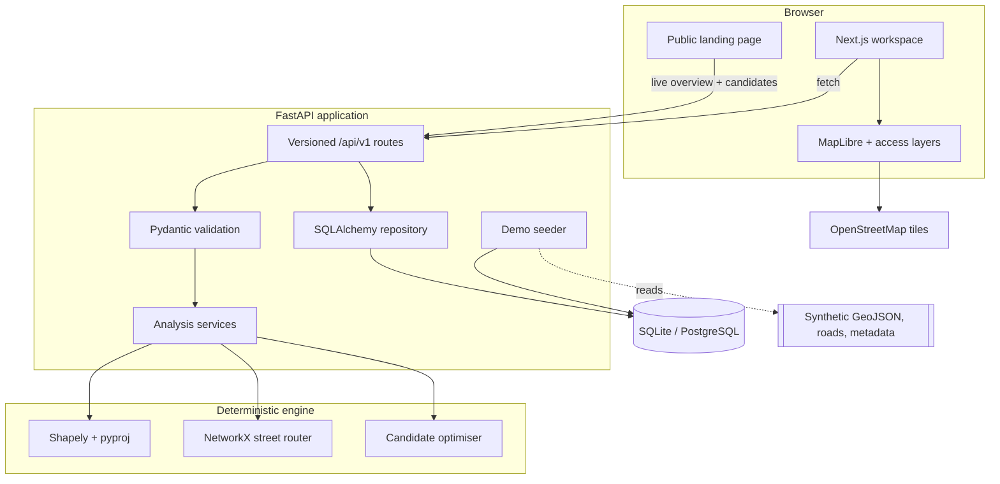
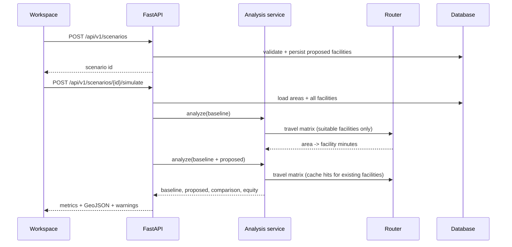

# Architecture

CareGap v0.1 is a two-application system with a deterministic Python analysis
engine and a Next.js workspace. It deliberately avoids microservices: the
analysis workload is small, reproducibility matters more than horizontal
elasticity, and the demo must run offline without paid infrastructure.

## Components

### Frontend (`frontend/`)

- Next.js App Router, React 19, TypeScript.
- Public landing at `/`; operational workspace at `/app/*`.
- MapLibre GL JS is loaded only on the client. The map container uses an
  explicit CSS class because MapLibre’s unlayered `.maplibregl-map` styles
  otherwise override Tailwind’s positioning utility.
- MapLibre’s worker is copied from `node_modules` into `public/` by
  `scripts/copy-maplibre-worker.mjs` during `predev`/`prebuild`, then registered
  with `maplibre.setWorkerUrl('/maplibre-gl-worker.mjs')`. This keeps the
  production Turbopack bundle functional.
- All displayed metrics come from the API; there are no hard-coded KPI values or
  fake charts. Loading, empty, and error states are explicit.
- `NEXT_PUBLIC_API_URL` selects the API origin. It is baked into the client build.

### Backend (`backend/`)

| Path | Responsibility |
| --- | --- |
| `app/main.py` | App factory, lifespan, CORS, security headers, routers. |
| `app/config.py` | Environment settings (`CAREGAP_*`). |
| `app/models.py` | SQLAlchemy models: datasets, areas, facilities, scenarios, import runs. |
| `app/seed.py` | Idempotent demo seeding from bundled GeoJSON. |
| `app/core/catalog.py` | Service, facility, and intervention definitions (single source of truth). |
| `app/services/routing.py` | Synthetic road router and documented straight-line fallback. |
| `app/services/analysis.py` | Service-filtered nearest facility, coverage, weighted statistics, equity, comparison. |
| `app/services/optimization.py` | Candidate evaluation, composite score, strategy comparisons, greedy sets. |
| `app/services/importer.py` | CSV/GeoJSON parsing, validation, duplicates, boundary checks. |
| `app/api/*` | Versioned REST routes and Pydantic response contracts. |
| `alembic/` | Versioned schema migration (`af8d1f78b2a6`). |

## Analysis flow

### Routing

The demo builds a 2.0 km synthetic grid (2.0 km spacing, deterministic edges and
speed classes) and computes shortest paths with Dijkstra. Population and
facility points snap to the nearest node; a local access leg is added at 18 km/h.
Per-facility node times are cached in memory for the router lifetime. The route
model identity and warnings are returned with every analysis.

If road data cannot load, the API uses a straight-line fallback with a 1.35
detour factor and 28 km/h, and labels it explicitly. It never claims that
straight-line distance is road travel time.

### Database

- SQLite by default, created at `backend/caregap.db`; `create_all` is used for
  local convenience. Alembic migrations are authoritative and run in Compose/CI.
- PostgreSQL is supported via `postgresql+psycopg://`. Verified against
  PostgreSQL 16 with the PostGIS 3.4 image; the app’s current schema stores
  GeoJSON in JSON columns and does not yet use native geometry types.
- `compose.yaml` enables the PostGIS extension through an init script for future
  native spatial work.
- All API writes occur in a request-scoped SQLAlchemy session; imports commit
  valid rows and record an `import_runs` provenance row.

### Error and security handling

- Pydantic validates every request body and query; FastAPI returns 422 for
  invalid requests.
- Domain errors use explicit 404/409/422 responses with readable `detail`.
- Unhandled errors are logged server-side and return `{"detail": "Internal server error"}`.
- CORS is allow-listed to configured origins.
- Response headers include `nosniff`, frame denial, and referrer policy.
- Imported files are read by size limit, validated, and never used as shell
  input or interpreted code.
- No authentication is included in the local build. Public deployment requires
  identity, authorisation, rate limiting, and audit logging.

## Important deviations

| Suggested | Implemented | Reason |
| --- | --- | --- |
| GeoPandas + PostGIS geometry | Shapely + pyproj over a portable schema | The demo is small; this provides a deterministic offline data path and simpler tests. PostGIS is available in Compose but not required. |
| Live OSRM/Valhalla | Synthetic street grid + labelled fallback | No external routing dependency or live-traffic claim; abstraction allows a real router later. |
| LLM explanations | Deterministic server-generated explanations | The tool must work without keys; arbitrary text is not allowed to invent numbers. |
| Microservices | Single FastAPI service | No demonstrated scaling need; keeps latency and operations simple. |

## Scaling path

1. Add an authenticated planning workspace and audit trail.
2. Store areas/facilities as PostGIS geometries and use spatial indexes.
3. Replace the synthetic router with a self-hosted OSRM/Valhalla profile and
   scheduled road-data refresh.
4. Add background jobs for large imports and scenario recomputation.
5. Cache baseline matrices by dataset version and expose job status.
6. Add observability (structured logs, metrics, traces) and cost controls.
